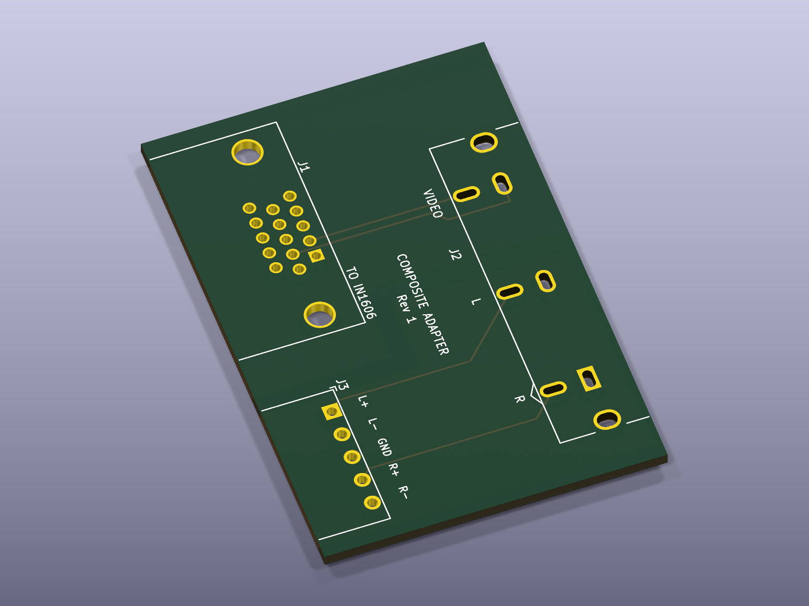
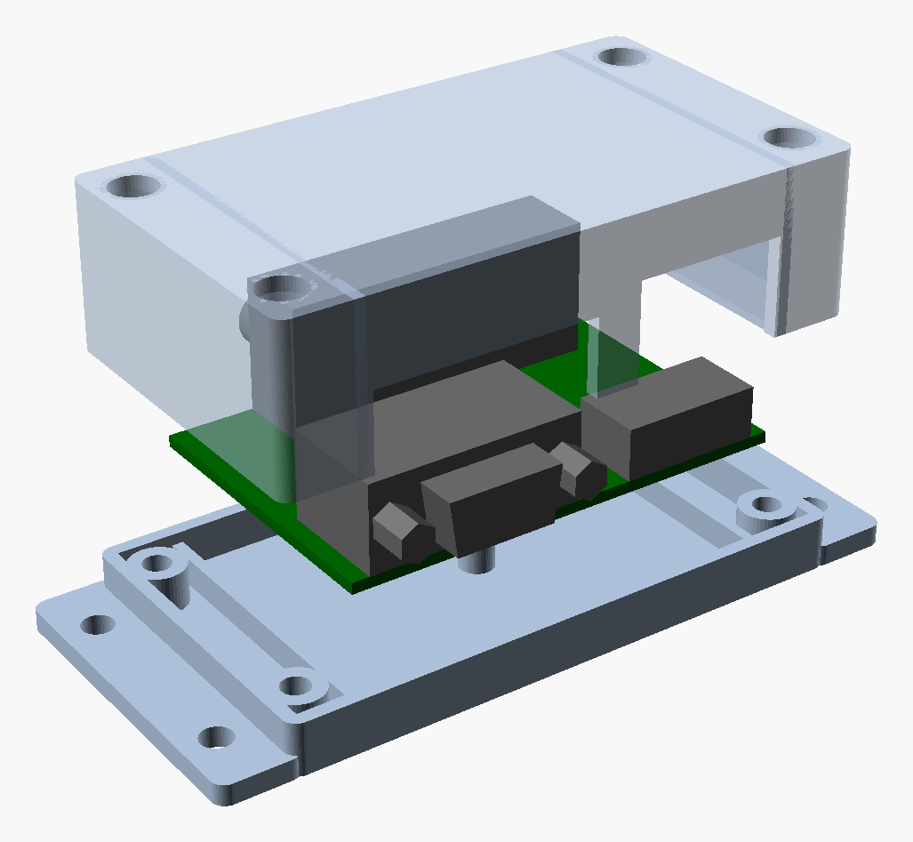

# Extron Composite Adapter

A small, passive breakout board for connecting a composite video source and
stereo analog audio to an Extron IN1606 scaling presentation switcher.

The IN1606's two analog video inputs use 15-pin HD (VGA-style) connectors. They
accept composite video, but there's no RCA jack to plug a source into. This
board routes a standard yellow/white/red RCA jack block onto the HD-15 pins the
IN1606 expects for composite video, and breaks out the stereo audio to a
3.5 mm 5-position pluggable header.

It is a companion to the
[Extron S-Video Adapter](https://github.com/mx-shift/extron-svideo-adapter),
and shares its HD-15 and audio connections, board outline, and case design.

J1 is a female HD-15, like the IN1606's inputs, so connect the two with a
male-to-male HD-15 (VGA) cable. A cable with all 15 conductors isn't needed;
pins 2, 7 and 10 must be connected.



## Specifications

- 2-layer, 1.6 mm FR-4, 43.18 × 63.5 mm
- All through-hole parts; no active components
- Designed in KiCad 10

## Connectors

| Ref | Function             | Part |
|-----|----------------------|------|
| J1  | HD-15 to IN1606      | [Amphenol L77HDE15SD1CH4F](https://www.amphenol-cs.com/product/l77hde15sd1ch4f.html) |
| J2  | RCA video, L, R      | [Same Sky (formerly CUI Devices) RCJ-32234](https://www.sameskydevices.com/product/interconnect/audio-connectors/rca-jacks/rcj-32) (red, white, yellow) |
| J3  | Audio header         | [TE Connectivity 284512-5](https://www.te.com/en/product-284512-5.html) (3.5 mm, 5-pos) |

The HD-15 and audio wiring follow the "Analog Video Connection" pinout table
and "Analog Audio Connection" figure in the IN1606/IN1608 user guide (Extron
document 68-2290-01), available from the
[IN1606 product page](https://www.extron.com/product/in1606).

## Pinout

### Video

| Signal       | J2 (yellow RCA) | J1 (HD-15) |
|--------------|:---------------:|:----------:|
| Video        | 6 (centre)      | 2          |
| Video return | 5 (sleeve)      | 7          |
| Ground       | –               | 10, shell  |

All other HD-15 pins are unconnected. J2's two mounting posts sit in plated
holes with no connection.

### Audio

| Signal       | J2 (RCA)                    | J3 (header) |
|--------------|:---------------------------:|:-----------:|
| Left         | 4 (white centre)            | 1           |
| Right        | 2 (red centre)              | 4           |
| Audio ground | 1, 3 (red and white sleeve) | 2, 3, 5     |

Audio ground is kept separate from the video/chassis ground.

J3 is a pluggable header. It mates with a
[TE 284506-5](https://www.te.com/en/product-284506-5.html) (or compatible
3.5 mm 5-position) screw-terminal plug, which you wire pin-for-pin to the
IN1606's 5-pole audio input plug (L+, L−, ⏚, R+, R−). This matches Extron's
unbalanced input wiring. The board already ties L− and R− to audio ground, so
don't add jumpers between − and ⏚ at the IN1606's plug.

## Revision history

- **Rev 1:** First design, derived from Rev 2 of the S-Video Adapter. Not yet
  fabricated or tested.

## Ordering boards

Download `extron-composite-adapter-<version>-oshpark.zip` from the
[latest release](https://github.com/mx-shift/extron-composite-adapter/releases/latest)
(or the `outputs` artifact of any Actions run). It contains the Gerbers and
the Excellon drill file. Upload the zip to [OSH Park](https://oshpark.com/).
The board is designed to OSH Park's 2-layer rules. Use the zip rather than the
`.kicad_pcb` file: the design is in KiCad 10 format, and OSH Park processes
uploaded board files with an older KiCad.

## Case



`case/case.scad` is a two-part, 3D-printable case. The bottom shell holds the
board on ledges along its two connector-free edges, and walls inside the top
shell clamp the same strips from above. The top shell's side walls have
openings for the connectors. Ears on the bottom shell let you screw the case
to a surface. Assembled, it measures 47.8 × 84.1 × 30.6 mm (104 mm long
including the ears).

STLs for both shells are attached to each
[release](https://github.com/mx-shift/extron-composite-adapter/releases/latest)
and to every Actions run (the `case` artifact), already oriented for printing.

Hardware:

- 4 × M3 × 25 socket head cap screws
- 4 × M3 heat-set inserts for 4.0 mm holes, at least 5 mm long (set
  `insert_d` to about 2.6 to self-tap the screws instead)
- 4 × #8 or M4 screws to mount the case (4.5 mm holes)

Printing: PLA or PETG, 0.2 mm layers, no supports. Print the bottom shell
floor-down and the top shell roof-down, as exported.

Assembly: install the inserts in the bottom shell, drop the board in, lower
the top shell over the connectors, and fit the screws.

The connector openings are sized from the manufacturers' drawings. The
`check` part in `case.scad` verifies that the case doesn't intersect the board
or the connector bodies. Mating plugs with oversized bodies or overmolds may
stop against the walls before fully seating: the RCA slots are 13.5 mm wide,
leaving about 6 mm of each barrel outside the wall, and the audio plug opening
is 21.7 × 14 mm. The audio plug opening was not checked against the mating
plug's drawing. Adjust the parameters at the top of `case.scad` if needed.

## Building

`scripts/build.sh` runs ERC and DRC, then writes the schematic PDF and the
OSH Park package to `output/`. GitHub Actions runs it in the `kicad/kicad`
container on every push and pull request; pushing a `v*` tag also publishes a
release with the zip, schematic PDF, and case STLs. To run it locally:

```sh
scripts/build.sh
# or, with the KiCad Flatpak:
KICAD_CLI="flatpak run --command=kicad-cli org.kicad.KiCad" scripts/build.sh
```

`scripts/build-case.sh` runs the case collision check and exports the STLs to
`output-case/`. It needs OpenSCAD.

The source location printed on the board and in the title blocks is the
`SOURCE_URL` project text variable (Schematic/Board Setup → Text Variables).

## Repository layout

- `extron-composite-adapter.kicad_pro`, `.kicad_sch`, `.kicad_pcb`: KiCad
  project
- `extron-composite-adapter.pretty/`: custom footprints for the connectors
  above. The project library table (`fp-lib-table`) loads them automatically.
- `case/case.scad`: 3D-printable case (OpenSCAD)
- `scripts/build.sh`, `scripts/build-case.sh`, `.github/workflows/build.yml`:
  design checks, fabrication outputs, and case STLs

## License

Copyright Rick Altherr 2026.

This hardware design is licensed under the CERN Open Hardware Licence
Version 2 - Strongly Reciprocal (SPDX: `CERN-OHL-S-2.0`). See
[LICENSE](LICENSE) for the full text.
